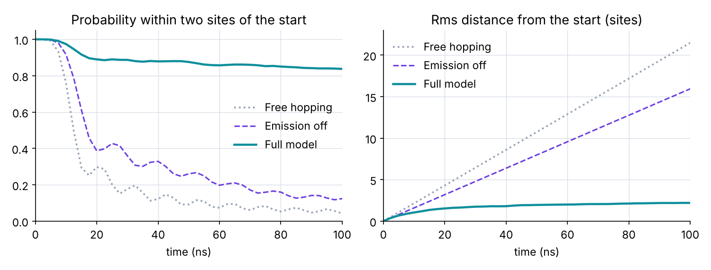
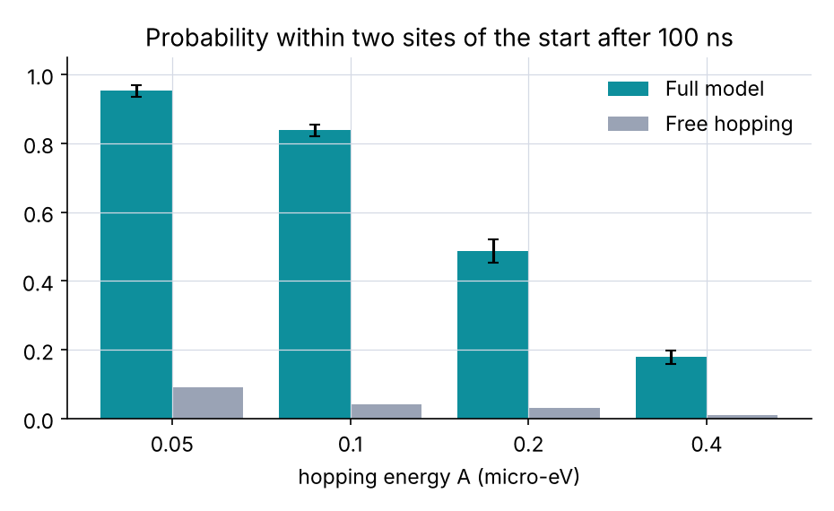

# Can an electron leave optical records of its own motion in a perfect crystal?

Project for Advanced Physics II (PH162), KAIST, Fall 2026. Adil Zhiyenbayev, 20261115.

This repository contains the complete model behind my presentation: the code, the numbers, the figures and the derivation of every formula. Anyone can run it and check the results.

## The question

> In an idealized, translationally invariant lattice of hydrogen-like atoms initially prepared in metastable 2s states, a single electron with hopping amplitude A would propagate coherently if it did not interact with atomic transitions. What happens to its coherence and transport when its position-dependent electric field mixes local 2s and 2p states, allowing 2p → 1s photon emission? Under which conditions is the effective Stark-quenching rate comparable to the electron hopping rate A/ħ, and can the emitted photons or resulting 1s atoms record the electron's path?

## The model in one paragraph

One electron hops between identical sites. Next to each site sits one atom with three levels (2s, 2p, 1s). The electric field of the electron mixes 2s and 2p on the two neighboring atoms, with a sign that depends on the side. The 2p level decays to 1s and emits a photon.

I solve two geometries with the same Hamiltonian:

* **a ring of three sites** (3 × 3³ = 81 states), where the Lindblad equation is integrated without further approximation;
* **a long chain of 31 sites**, where I average quantum trajectories.

```
H = −A (T + T†)  +  Σ_i H_atom,i  +  g Σ_i (n_{i+1} − n_{i−1}) ⊗ X_i          L_i = √Γ |1s⟩_i⟨2p|
    electron hops    atomic levels    the electron's field mixes 2s and 2p     photon emission
```

**Every term is derived step by step in [docs/derivation.md](docs/derivation.md).**

## How to run it

```bash
python -m venv .venv && . .venv/bin/activate
pip install -r requirements.txt
python run_all.py        # ring: all numbers   -> results/results.json and results/*.csv   (about 1 minute)
python run_chain.py      # long chain          -> results/chain.json and results/chain_*.csv (about 30 minutes on two cores)
python make_figures.py   # all figures         -> figures/*.png
python -m pytest -q      # 17 checks of the model                                           (about 2 minutes)
```

Tested with Python 3.13, NumPy 2.5 and SciPy 1.18.

## What is in the repository

| Path | Content |
|---|---|
| `model/ring.py` | The ring of three sites: Hamiltonian, jump operators, two independent solvers, observables |
| `model/chain.py` | The long chain: quantum trajectories, and an exact solver for short chains as a check |
| `model/atom.py` | One hydrogen atom in a static field: dipole matrix element, quench rate, its ceiling |
| `run_all.py` | Reproduces every number and curve of the ring |
| `run_chain.py` | Reproduces every number and curve of the long chain |
| `make_figures.py` | Draws the figures from the CSV files |
| `tests/` | Checks: physical state, known limits, two solvers, trajectories against the exact solution, reference numbers |
| `results/` | `results.json` and the CSV files written by `run_all.py` |
| `figures/` | The figures written by `make_figures.py` |
| `docs/derivation.md` | Where every formula comes from, with references |

## Main results

**The electron can trap itself.** On a long chain with slow hopping it quenches the atoms next to it. An excited neighbor raises the energy of the electron by 0.52 μeV (level repulsion of 2s and 2p), and a quenched neighbor does not. So the electron digs a potential well of depth 1.05 μeV and stays in it. The two dark atoms are the optical record of where it is.

| Question | Result |
|---|---|
| Q1. Coherence and transport | Ring, A = 1.0 μeV: at 12 ns the current is 21.7% of its initial value and the coherence is 0.411. With emission switched off the current keeps reviving (26% to 97%). |
| Q2. When do the clocks match? | For hydrogen at 1 kV/m the quench time is 3.64 μs, and one hop with A = 1 meV takes 0.66 ps. The quench rate can never exceed Γ/2 = 3.1 × 10⁸ s⁻¹, so the clocks match only for A below about 0.21 μeV. |
| Q3. Do the atoms record the path? | Ring: the pattern of 1s atoms carries only 0.008 bit about the electron site. Long chain: after 100 ns the electron sits between two 1s atoms with 93% probability. |
| Is the electron trapped? | Ring: no, the three atoms run out. Long chain (31 sites, A = 0.1 μeV): after 100 ns, 84% of the probability is still within two sites of the start. Free hopping keeps 4%, and the model with emission switched off keeps 12%. |
| Does it need slow hopping? | Yes. The kept probability is 95%, 84%, 49% and 18% for A = 0.05, 0.1, 0.2 and 0.4 μeV. |

Common parameters: g = 1.6 μeV, Δ = 4.37 μeV, Γ = 0.625 ns⁻¹. All atoms start in 2s.






## Checks

* Two independent solvers (Runge-Kutta on the density matrix, and a matrix exponential of the full Liouvillian) agree to 3 × 10⁻¹³.
* The trace stays 1, and the density matrix stays Hermitian and positive.
* With the mixing switched off nothing changes in time. Free hopping follows the exact formula (5 + 4 cos(3At/ħ))/9.
* The 1s energy cancels and changes no result.
* On a chain of four sites the average of 1500 quantum trajectories agrees with the exact Lindblad solution within the statistical error. The long-chain result is the same for 11, 21 and 31 sites.
* The dipole matrix element is computed from the hydrogen wave functions: ⟨2s|z|2p, m=0⟩ = −3a₀ and |⟨2s₁/₂|z|2p₁/₂⟩| = √3 a₀.

## Limits

The atoms emit independently, the field is short-ranged and unscreened, and nothing excites the atoms again. The long chain has 31 sites and the run lasts 100 ns, so I cannot say yet whether the trap is permanent. The parameters A and g are illustrative and do not describe a specific material. See section 11 of the derivation.

## Main references

Feynman, Leighton and Sands, *The Feynman Lectures on Physics*, Vol. III, ch. 8 and 13. Lamb and Retherford, Phys. Rev. 79, 549 (1950). Bezginov et al., Science 365, 1007 (2019). Wiese and Fuhr, J. Phys. Chem. Ref. Data 38, 565 (2009). Dalibard, Castin and Mølmer, Phys. Rev. Lett. 68, 580 (1992). The full list is in [docs/derivation.md](docs/derivation.md).
