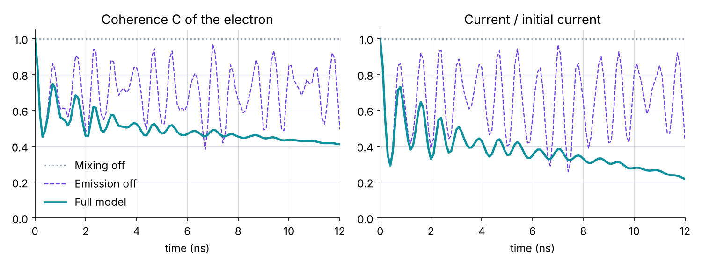
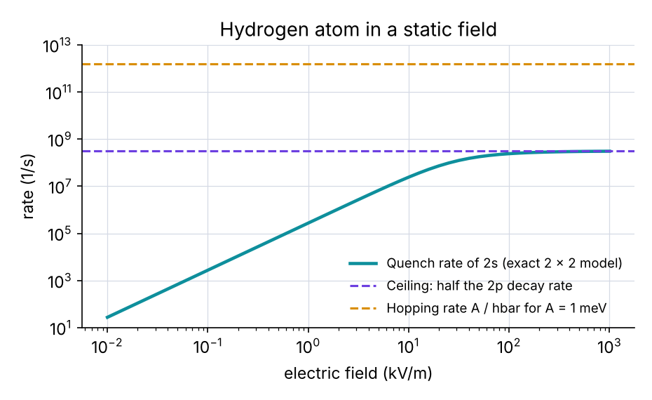

# Can an electron leave optical records of its own motion in a perfect crystal?

Project for Advanced Physics II (PH162), KAIST, Fall 2026. Adil Zhiyenbayev, 20261115.

This repository contains the complete model behind my presentation: the code, the numbers, the figures and the derivation of every formula. Anyone can run it and check the results.

## The question

> In an idealized, translationally invariant lattice of hydrogen-like atoms initially prepared in metastable 2s states, a single electron with hopping amplitude A would propagate coherently if it did not interact with atomic transitions. What happens to its coherence and transport when its position-dependent electric field mixes local 2s and 2p states, allowing 2p → 1s photon emission? Under which conditions is the effective Stark-quenching rate comparable to the electron hopping rate A/ħ, and can the emitted photons or resulting 1s atoms record the electron's path?

## The model in one paragraph

One electron hops on a ring of three identical sites. Next to each site sits one atom with three levels (2s, 2p, 1s). The electric field of the electron mixes 2s and 2p on the two neighboring atoms, with a sign that depends on the side. The 2p level decays to 1s and emits a photon. The joint system has 3 × 3³ = 81 states, and I solve its Lindblad equation without further approximation.

```
H = −A (T + T†)  +  Σ_i H_atom,i  +  g Σ_i (n_{i+1} − n_{i−1}) ⊗ X_i          L_i = √Γ |1s⟩_i⟨2p|
    electron hops    atomic levels    the electron's field mixes 2s and 2p     photon emission
```

**Every term is derived step by step in [docs/derivation.md](docs/derivation.md).**

## How to run it

```bash
python -m venv .venv && . .venv/bin/activate
pip install -r requirements.txt
python run_all.py        # all numbers  -> results/results.json and results/*.csv   (about 1 minute)
python make_figures.py   # all figures  -> figures/*.png
python -m pytest -q      # 11 checks of the model                                   (about 1 minute)
```

Tested with Python 3.13, NumPy 2.5 and SciPy 1.18.

## What is in the repository

| Path | Content |
|---|---|
| `model/ring.py` | The 81-state model: Hamiltonian, jump operators, two independent solvers, observables |
| `model/atom.py` | One hydrogen atom in a static field: dipole matrix element, quench rate, its ceiling |
| `run_all.py` | Reproduces every number and curve of the presentation |
| `make_figures.py` | Draws the figures from the CSV files |
| `tests/test_model.py` | Checks: physical state, known limits, two solvers, reference numbers |
| `results/` | `results.json` and the CSV files written by `run_all.py` |
| `figures/` | The figures written by `make_figures.py` |
| `docs/derivation.md` | Where every formula comes from, with references |

## Main results

Reference run: A = 1.0 μeV, g = 1.6 μeV, Δ = 4.37 μeV, Γ = 0.625 ns⁻¹. The electron starts in the circulating state and all atoms start in 2s.

| Question | Result |
|---|---|
| Q1. Coherence and transport | At 12 ns the current is 21.7% of its initial value and the coherence is 0.411. With emission switched off the current keeps reviving (26% to 97%). |
| Q2. When do the clocks match? | For hydrogen at 1 kV/m the quench time is 3.64 μs, and one hop with A = 1 meV takes 0.66 ps. The quench rate can never exceed Γ/2 = 3.1 × 10⁸ s⁻¹, so the clocks match only for A below about 0.21 μeV. |
| Q3. Do the atoms record the path? | At least one atom has emitted with probability 70.7% at 12 ns, but the pattern of 1s atoms carries only 0.008 bit about the electron site. A perfect record would carry 1.58 bits. |
| Is the electron trapped? | Not on this ring. After 300 ns, 99.99% of the atoms are in 1s, the mixing is gone and free hopping returns. A long chain is the open test. |





## Checks

* Two independent solvers (Runge-Kutta on the density matrix, and a matrix exponential of the full Liouvillian) agree to 3 × 10⁻¹³.
* The trace stays 1, and the density matrix stays Hermitian and positive.
* With the mixing switched off nothing changes in time. Free hopping follows the exact formula (5 + 4 cos(3At/ħ))/9.
* The 1s energy cancels and changes no result.
* The dipole matrix element is computed from the hydrogen wave functions: ⟨2s|z|2p, m=0⟩ = −3a₀ and |⟨2s₁/₂|z|2p₁/₂⟩| = √3 a₀.

## Limits

The atoms emit independently, the field is short-ranged and unscreened, nothing excites the atoms again, and the ring has only three sites. The parameters A and g are illustrative and do not describe a specific material. See section 10 of the derivation.

## Main references

Feynman, Leighton and Sands, *The Feynman Lectures on Physics*, Vol. III, ch. 8 and 13. Lamb and Retherford, Phys. Rev. 79, 549 (1950). Bezginov et al., Science 365, 1007 (2019). Wiese and Fuhr, J. Phys. Chem. Ref. Data 38, 565 (2009). Dalibard, Castin and Mølmer, Phys. Rev. Lett. 68, 580 (1992). The full list is in [docs/derivation.md](docs/derivation.md).
